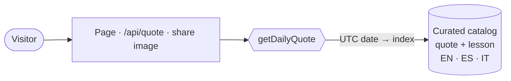

# Estoico en producción

**English** · [Español](README.es.md) · [Italiano](README.it.md)

*Stoic calm for systems that fail.* One stoic quote a day and a one-line lesson that translates it to a developer's life, in English, Spanish and Italian, ready to share as an image on Instagram, WhatsApp or Google Chat.

> “Some things are within our power, while others are not.” (Epictetus, *Enchiridion* 1)
>
> `// The other side's API isn't up to you. The timeout, the retry and the alert are.`

The idea behind it is the stoic dichotomy of control applied to integrations: you don't control whether the API on the other side goes down; you do control the retries, the idempotency, the alerts and how you react. The name is a proper noun and stays in Spanish in every language.

<!-- Demo: add the production URL here once deployed -->

## How it works



1. **Catalog**: `src/lib/quotes/catalog.ts` holds every entry: a quote attributable to a specific work, plus a dev lesson, both written and translated by hand.
2. **Daily rotation**: entry N is shown on day N after launch (UTC). The same date always gives the same entry on every server instance, so the page, the JSON API, the share image and any future automation agree without caches, shared state or race conditions. **A quote is never repeated**: when the catalog runs out, the page says there is no new quote, the API answers 404, and the app shows how many days of content are left (highlighted below 7).
3. **Sharing**: `/api/quote/card` renders the quote and the lesson as a PNG (story, feed post or link preview) with `next/og`, in the brand's colours, fonts and symbol. On mobile, the share button opens the native share sheet.

## Design decisions

| Decision | Why |
|---|---|
| **Curated catalog instead of a quote API** | Each lesson is written for its quote, so the quote must be known in advance. Hand-written translations also avoid machine-translation artefacts and dubious attributions from crowd-sourced APIs. |
| **Deterministic rotation by UTC date, no wrap-around** | No storage and no "quote of the day" to keep in sync: the date *is* the key. Every route agrees by construction, and a published quote never comes back. |
| **Length limits checked by tests** (quote ≤ 170, lesson ≤ 110 characters per language) | Both always fit the share card; a too-long entry fails CI instead of overflowing an image. |
| **Cache until UTC midnight** | The content is fixed for the day, so shared caches can keep it exactly until it changes. |
| **`fetchWithRetry` kept** (timeout per attempt, retries only network errors/timeouts/429/5xx, backoff with jitter, `Retry-After`) | Ready for the upcoming Instagram auto-post, which calls the Meta API. |

## Adding entries

Add an object to `CATALOG` in `src/lib/quotes/catalog.ts`:

```ts
{
  id: "obstacle-is-the-way",          // unique slug
  author: "marcus",                   // key of AUTHORS
  work: "meditations",                // key of WORKS
  ref: "5.20",                        // book/chapter/letter, or "" if none
  quote: { es: "…", en: "…", it: "…" },
  lesson: { es: "…", en: "…", it: "…" },
}
```

Rules: the quote must be attributable to a specific work; lessons are generic patterns of the craft (never stories from real projects); `npm test` checks completeness and length. **The catalog is append-only**: add new entries at the end and never reorder or remove existing ones, or a quote already shown could come back on a later day.

## API

```
GET /api/quote                       → today's quote + lesson in every language (404 if there is none)
GET /api/quote?lang=es               → one language (en | es | it)
GET /api/quote/card?lang=it&format=story&theme=dark
                                     → PNG: story 1080×1920 · post 1080×1350 · og 1200×630
                                       theme: light · dark (the share button follows the visitor's theme)
```

In development only, `/api/quote/card?id=<catalog id>` renders a specific entry, to preview cards.

```json
{
  "date": "2026-11-23",
  "id": "opinions-not-things",
  "author": { "en": "Epictetus", "es": "Epicteto", "it": "Epitteto" },
  "work": { "en": "Enchiridion 5", "es": "Enquiridión 5", "it": "Manuale 5" },
  "text": { "en": "…", "es": "…", "it": "…" },
  "lesson": { "en": "…", "es": "…", "it": "…" }
}
```

## Run it

```bash
npm install
npm run dev        # http://localhost:3000
```

No API keys needed. Optional environment variables:

| Variable | Use |
|---|---|
| `NEXT_PUBLIC_SITE_URL` | Public URL, for link previews (`og:image`). |
| `NEXT_PUBLIC_BRAND_NAME`, `NEXT_PUBLIC_BRAND_URL` | Who signs the page and the images (defaults in `src/lib/brand.ts`). |
| `SHARE_FOOTER` | Text at the bottom of the share image. Defaults to the brand URL's host. |

## Quality

```bash
npm run lint
npm run typecheck
npm test           # Vitest: catalog completeness and lengths, rotation, retries and timeouts
npm run build
```

CI (GitHub Actions) runs all four on every push and pull request.

## Stack

Next.js 16 · React 19 · TypeScript · Tailwind CSS 4 · Vitest · `next/og`.
Fonts: Bricolage Grotesque, IBM Plex Sans and JetBrains Mono (SIL Open Font License, in `assets/fonts/`).

## Structure

```
src/
  lib/quotes/catalog.ts          curated quotes + dev lessons (EN · ES · IT)
  lib/quotes/getDailyQuote.ts    deterministic daily rotation
  lib/http/fetchWithRetry.ts     timeout, selective retries, backoff
  lib/share/renderCard.tsx       share image
  lib/brand.ts                   app name, tagline, author
  components/                    page card and VFH symbol
  app/api/quote/                 JSON API and share image endpoint
tests/                           Vitest suites
```

Quotes come from public-domain works by Epictetus, Marcus Aurelius, Seneca and Zeno (via Diogenes Laërtius). Built by [Valery Figueroa Huaman](https://valeryfigueroahuaman.com).
