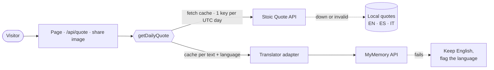

# Daily Stoic

**English** · [Español](README.es.md) · [Italiano](README.it.md)

One stoic quote a day, in English, Spanish and Italian, ready to share as an image on Instagram, WhatsApp or Google Chat.

The app is small on purpose. What it shows is how to **integrate third-party APIs so they don't break**: timeouts, selective retries, response validation, a fallback when the upstream is down, caching that respects a free quota, and adapters that can be swapped without touching the rest of the code.

<!-- Demo: add the Vercel URL here once deployed -->

## How it works



1. **Quote**: `stoicProvider` calls the [Stoic Quote API](https://stoic.tekloon.net/stoic-quote) and validates the response with `zod`.
2. **Fallback**: if the API is down, times out or returns something unexpected, a curated, pre-translated local quote is served (the same one for the whole day). It is not cached, so the app goes back to live as soon as the API recovers.
3. **Translation**: Spanish and Italian are requested in parallel from [MyMemory](https://mymemory.translated.net) through the `Translator` interface. If one language fails, only that language falls back to English; the page never fails.
4. **Sharing**: `/api/quote/card` renders the quote as a PNG (story, feed post or link preview) with `next/og`. On mobile, the share button opens the native share sheet.

## Integration decisions

| Decision | Why |
|---|---|
| **Timeout on every attempt** (4s) | An upstream that hangs must not hang the page. |
| **Retries only network errors, timeouts, 429 and 5xx** | A 4xx means our request is wrong; sending it again will not fix it. |
| **Exponential backoff with jitter, honours `Retry-After`** | Avoids retrying in lockstep and respects the provider's rate limits. |
| **Response validation with `zod`** | If the API changes shape, we get a clear error and the fallback, not `undefined` on screen. |
| **MyMemory errors read from the body** | It answers HTTP 200 even when it fails; the real status is in `responseStatus` and `quotaFinished`. |
| **Translation output sanitised** | Translation memories return artefacts (HTML entities, stray quote marks). They are cleaned, and covered by tests. |
| **Quote cached once per UTC day** | The upstream returns a *random* quote per call. The request URL carries the date, so Next's fetch cache has a single key per day, shared by the page, the JSON API and the share image. |
| **Translations cached per text + language, only on success** | About 2 MyMemory calls a day, far below its free quota (~5,000 chars/day without a key). A failed translation is retried on the next request instead of staying broken. |
| **`Translator` interface** | Moving to DeepL or Google Translate means writing one adapter in `src/lib/translation/`. Nothing else changes. |

Known limit: on the first request of the day, two simultaneous cache misses on different server instances can each fetch a different random quote. The last write wins and every request after that agrees. Requests on the same instance share one in-flight call.

## API

```
GET /api/quote                       → today's quote in every language
GET /api/quote?lang=es               → one language (en | es | it)
GET /api/quote/card?lang=it&format=story&theme=dark
                                     → PNG: story 1080×1920 · post 1080×1350 · og 1200×630
                                       theme: light · dark (the share button follows the visitor's theme)
```

```json
{
  "date": "2026-11-22",
  "author": "Seneca",
  "text": { "en": "…", "es": "…", "it": "…" },
  "source": "live",
  "translation": "ok"
}
```

`source` is `live` or `fallback`; `translation` is `ok`, `partial` or `unavailable`.

## Run it

```bash
npm install
npm run dev        # http://localhost:3000
```

No API keys needed. Optional environment variables:

| Variable | Use |
|---|---|
| `NEXT_PUBLIC_SITE_URL` | Public URL, for link previews (`og:image`). |
| `NEXT_PUBLIC_BRAND_NAME`, `NEXT_PUBLIC_BRAND_URL` | Who signs the page and the images (defaults in `src/lib/brand.ts`). |
| `SHARE_FOOTER` | Text at the bottom of the share image. Defaults to the brand URL's host. |
| `STOIC_API_URL`, `MYMEMORY_API_URL` | Point to another endpoint, e.g. an unreachable one to try the fallback. |

## Quality

```bash
npm run lint
npm run typecheck
npm test           # Vitest: retries, timeouts, validation, fallback, sanitising
npm run build
```

CI (GitHub Actions) runs all four on every push and pull request.

## Stack

Next.js 16 · React 19 · TypeScript · Tailwind CSS 4 · zod · Vitest · `next/og`.
Fonts: Bricolage Grotesque and IBM Plex Sans (SIL Open Font License, in `assets/fonts/`).

## Structure

```
src/
  lib/http/fetchWithRetry.ts     timeout, selective retries, backoff
  lib/quotes/stoicProvider.ts    upstream client + validation
  lib/quotes/localQuotes.ts      curated fallback (EN · ES · IT)
  lib/quotes/buildDailyQuote.ts  orchestration: source → fallback → translations
  lib/quotes/getDailyQuote.ts    caching and wiring
  lib/translation/               Translator interface + MyMemory adapter
  lib/share/renderCard.tsx       share image
  app/api/quote/                 JSON API and share image endpoint
tests/                           Vitest suites
```
